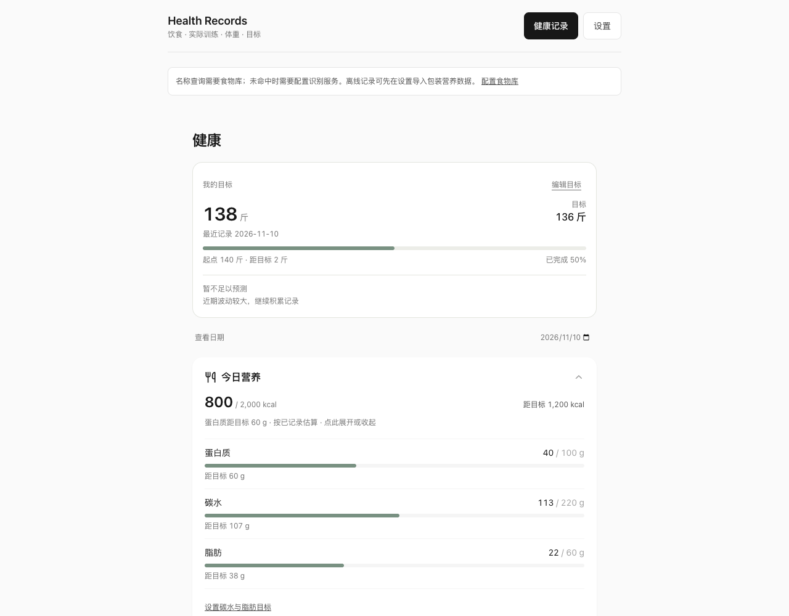
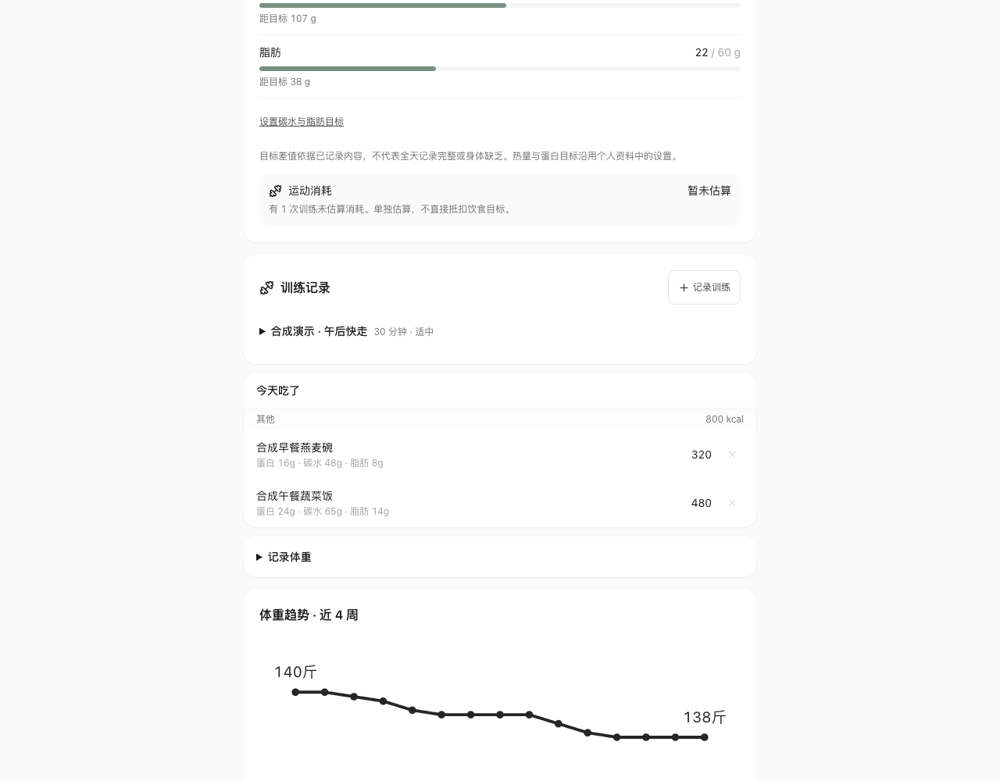
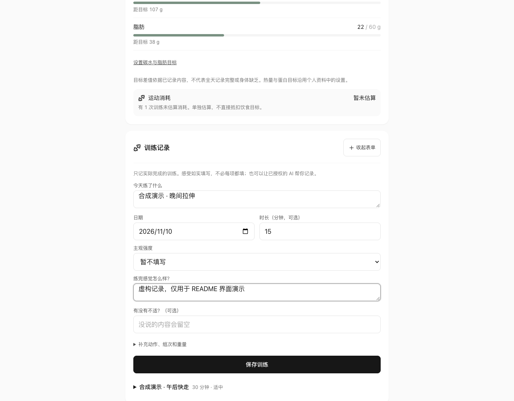
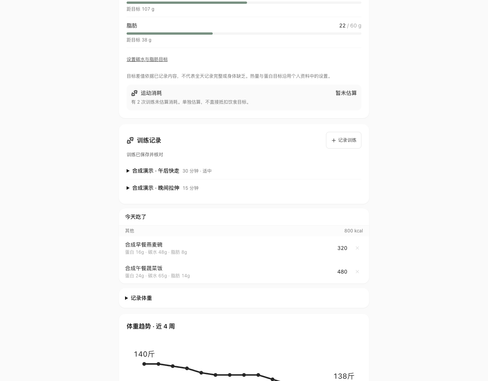

[简体中文](README.md) | [English](README.en.md)

# health-records

A personal health records web app + MCP. Meals, actual workouts, weight, and goals live on your own WebDAV server; the browser and Agent read and write the same JSON files.



_The screenshots use fictional profiles, synthetic records, and demonstration nutrition values. They are neither personal health data nor nutrition advice._

## Run locally

Requires Node.js 22 or later.

```bash
npm ci
npm run build
npm start
```

Open `http://127.0.0.1:18740`. Set the WebDAV URL to `http://127.0.0.1:18740/dav/`, username to `demo`, and password to `demo-only`. These are explicitly public local development credentials. The service listens only on loopback; data is stored in `.local-data/` and persists across restarts. It is neither a general-purpose production WebDAV server nor a multi-user system. Do not expose this port to the public internet.

The first run contains no real records or default nutrition data. After setting up your profile, you can log workouts, weight, and goals. Food-name lookup requires importing a food library; estimating unknown foods from text/photos requires the optional recognition service below. Without a library or model, MCP can still save nutrition values explicitly supplied by the user.

For frontend development, run `npm run dev` in another terminal and visit `http://127.0.0.1:5173`. The local storage/recognition service still requires `npm start`. Browser credentials are stored in localStorage for that origin. Use a separate account with minimal permissions, and do not save credentials on untrusted shared devices.

## Production storage: your own WebDAV

Use the same URL, username, and password in the web settings and MCP configuration. External services must use HTTPS and support strong ETags, `If-Match`, `If-None-Match: *`, and read-back verification. Direct browser access requires correctly configured CORS with `ETag` exposed. Services that do not meet the version preconditions will have record writes rejected.

Create `personal/<username>/body/` and `bills/` directories first. Usernames allow only ASCII letters, digits, underscores, and hyphens. The file paths are:

- `personal/<username>/body/food.json`, `workouts.json`, `weights.json`, `health-goals.json`, `profile.json`
- `bills/_settings.json` is the compatible storage-selection file. If absent, the personal directory above is used; an explicit `body: "shared"` selects `bills/body/`. The local development adapter provides only the personal directory.

MCP and the browser use conditional writes, complete original-snapshot checks, and read-back confirmation for food and health records. The profile page retains whole-file saves for the single-owner `profile.json`; concurrent edit merging is not yet provided. Restrict accessible directories on the server and back up your actual data. This project provides no hosted service.

## Review meals, workouts, and weight

Record meals, edit portions, and log workouts and weight in the browser, or ask an MCP-compatible client to record them and review the results in the web app. Updates carry versions, saves are read back, and repeated requests do not create duplicates. Missing records are shown as missing information, rather than treated as evidence that nothing happened.

Review recorded meals, enter actual workouts, and view weight trends on the same page.







## Food library

The source does not include third-party nutrition tables with unclear redistribution rights, and test data is not presented as real nutrition values. Import verified per-100g data you have the right to use. The page supports search, portion conversion, and calibration of recognition results against library values.

Download a template from Settings or edit the [template file](public/food-library-template.json): supply the source and name, replace `null` with nonnegative numbers from packaging or licensed data, then import it. Templates with missing values are rejected. See [food-library.ts](src/lib/food-library.ts) for optional fields and validation. Imported libraries stay in the current browser. MCP accepts confirmed nutrition values and does not automatically query the browser's food library.

## Optional photo and narrated-text recognition

Photo uploads and narrated-text recognition are supported. Recognition uses an OpenAI-compatible `/chat/completions` service. Keys are read only by the local service at runtime and never enter the frontend build. For example, set `HEALTH_AI_BASE_URL` to `https://api.openai.com/v1`, and configure models that support text/image input respectively:

```bash
# Inject these through your runtime or credential manager; never commit real values:
# HEALTH_AI_BASE_URL, HEALTH_AI_KEY, HEALTH_AI_TEXT_MODEL, HEALTH_AI_VISION_MODEL
npm start
```

Without configuration, recognition is explicitly unavailable; results are never fabricated. Review the editable draft after text parsing before saving; after photo recognition, check the name and portion. Manual entry with no library match requests an estimate using the supplied name/portion and saves it; review the result afterward. Images are sent to your configured model service and may incur charges. Upload only images you are willing to send. This is for estimation and personal review, not medical use.

## MCP stdio

Clients supporting local MCP can use:

```json
{
  "mcpServers": {
    "health-records": {
      "command": "node",
      "args": ["/absolute/path/to/health-records/scripts/mcp-stdio.mjs"],
      "env": {
        "HEALTH_WEBDAV_URL": "http://127.0.0.1:18740/dav/",
        "HEALTH_WEBDAV_USER": "demo",
        "HEALTH_WEBDAV_PASSWORD": "demo-only"
      }
    }
  }
}
```

This is a local development example only. Inject production credentials at client runtime; do not commit them. The 14 tools cover meal list/add/update, workout list/add/update, weight list/add/update, goal get/set, and `health_context`.

Agents must record only actual behavior reported by the user. Use stable `id` and `mutation_id` values for retries, and read the complete `expected` snapshot before updates. If a save result is uncertain, read the original ID first and replay the same request; do not record it again under a new ID. Tools return structured errors and `write_may_have_succeeded`.

## OAuth HTTP MCP

`npm run mcp:http` reuses the same storage. Set these at runtime:

- `HEALTH_MCP_PUBLIC_BASE`: external HTTPS base URL including its path, for example `https://health.example.org/agent`.
- `HEALTH_MCP_STATE_DIR`: a separate persistent authorization-state directory.
- `HEALTH_WEBDAV_URL`, `HEALTH_WEBDAV_USER`, `HEALTH_WEBDAV_PASSWORD`.
- Optional `HEALTH_MCP_PORT` (default 18725).

The service listens only on `127.0.0.1`; external access requires your own HTTPS reverse proxy. The MCP endpoint is the base URL plus `/mcp`. OAuth uses PKCE, one-time owner consent, separate food/health read/write scopes, token rotation, and revocation. Unauthorized requests return 401; there is no public unauthenticated mode. To enable all health capabilities, explicitly request `food:read food:write health:read health:write` during authorization. When scopes are omitted, only food access is granted by default for client compatibility; permissions for workouts, weight, and goals are not automatically added. The internal `food` profile key is retained but supports all health scopes above. Only one process may use an authorization-state directory at a time.

## Tests and limitations

```bash
npm test
npm run build
```

Unit and integration tests use synthetic records, local DAV, and mock providers, with no real user records, credentials, or paid requests. The [acceptance record](docs/acceptance.md) distinguishes real protocol/browser workflows from real-model quality.

Dates follow Asia/Shanghai. Records and statistics reflect only what has been recorded. Energy, nutrition gaps, and time estimates for weight goals are heuristic; missing profile information must not be invented. Food libraries and models may be wrong and must not be used to diagnose diseases or determine treatment.

### Recovering the local development service lock

Only one service process may use a data directory. If the port is occupied, startup fails and releases the lock created by that attempt; retry with another `HEALTH_LOCAL_PORT`. A normal exit removes `.writer.lock`.

A forced termination or power loss may leave the lock behind. First confirm that no process is still using the data directory, back up the data, then manually remove `.writer.lock` from that directory and restart. Never remove the lock while the service is running. Startup logs explicitly report lock contention; the service never bypasses it automatically.

Other development settings: `HEALTH_LOCAL_DATA_DIR`, `HEALTH_LOCAL_USER`, `HEALTH_LOCAL_PASSWORD`. If you change the port or account, update both the browser and MCP configuration. Do not run demos with real production credentials.

## License

MIT; see [LICENSE](LICENSE). This license covers only original/authorized source in this repository. User-imported data and model services are subject to their own licenses or terms. See dependency packages for their licenses. This repository does not distribute the original workbench history, private configuration, real records, or unauthorized food data.
