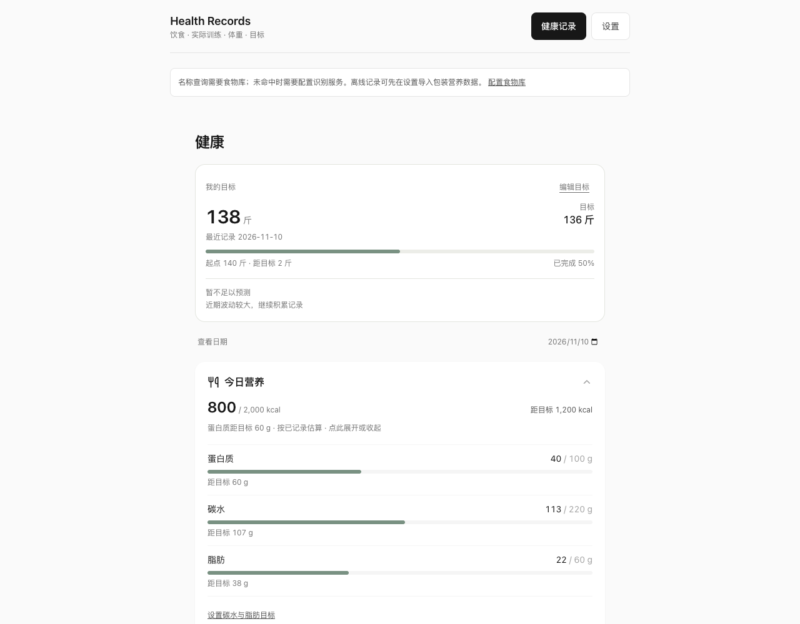
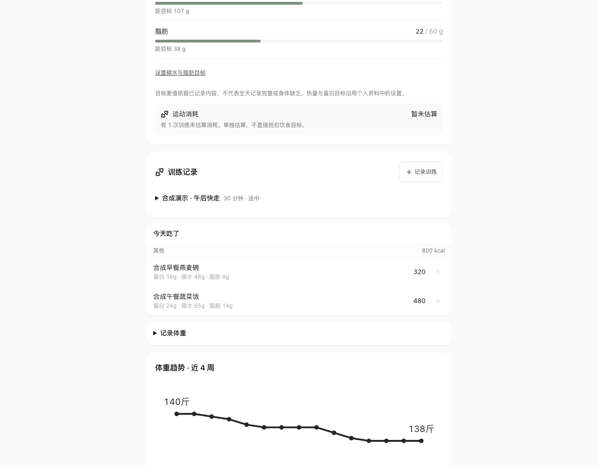
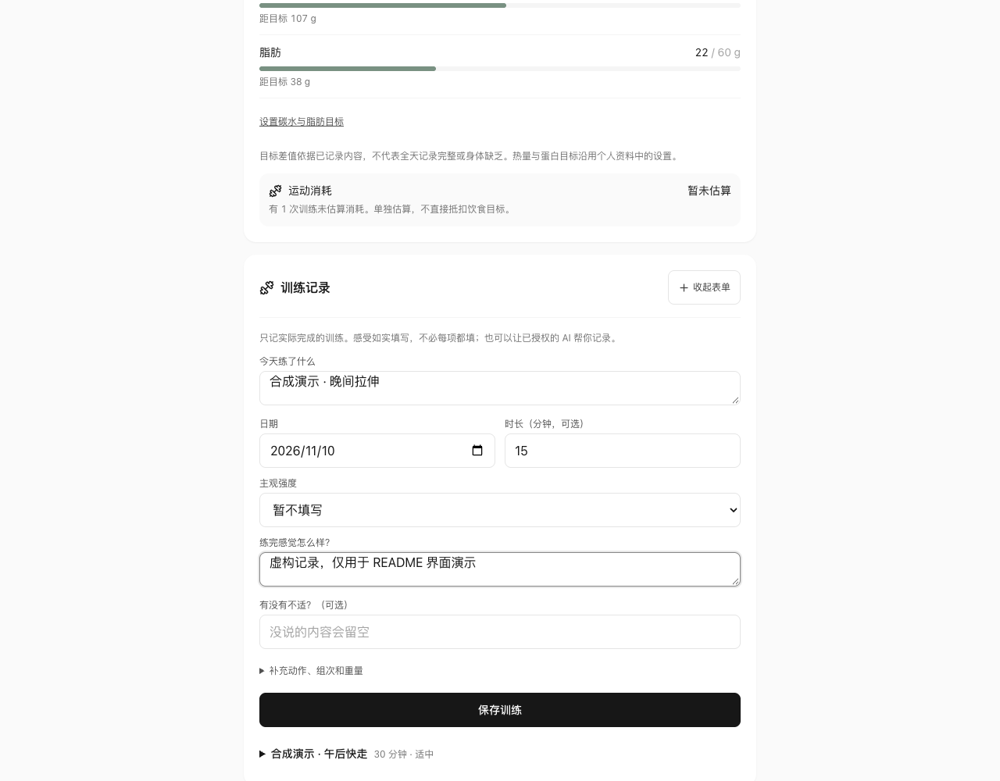
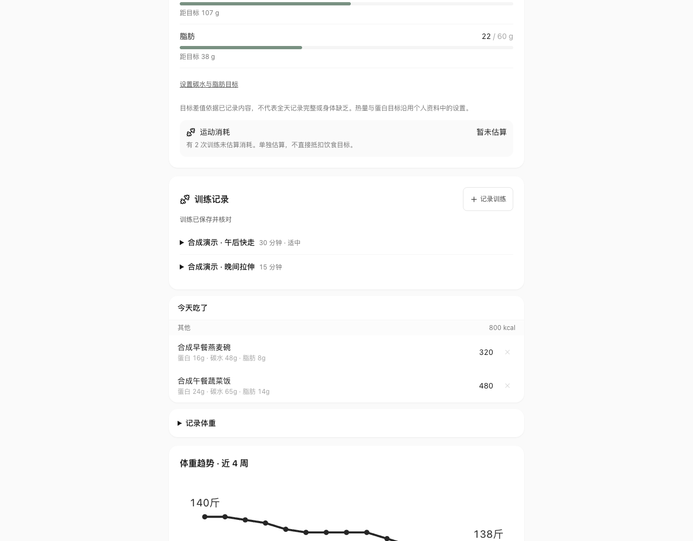

[简体中文](README.md) | [English](README.en.md)

# health-records

个人健康记录网页 + MCP。饮食、实际训练、体重和目标保存在你自己的 WebDAV，网页与 Agent 读写同一份 JSON。



_截图使用虚构资料、合成记录和演示营养数值，不是个人健康数据或营养建议。_

## 本地启动

需要 Node.js 22 或更新版本。

```bash
npm ci
npm run build
npm start
```

打开 `http://127.0.0.1:18740`。设置 WebDAV URL 为 `http://127.0.0.1:18740/dav/`，用户名 `demo`，密码 `demo-only`。这是明确公开的本地开发账号，服务只监听回环地址；数据落在 `.local-data/`，重启保留。它不是生产通用 WebDAV 服务，也不是多用户系统。不要把这个端口转发到公网。

首次没有任何真实记录，也没有默认营养数据。设置个人资料后，可记录训练、体重和目标。食品名称查询需要导入食物库；未知食品的文字/照片估算需要配置下方可选识别服务。没有库或模型时，MCP 仍可保存用户明确提供的饮食数值。

开发前端：另一个终端运行 `npm run dev`，访问 `http://127.0.0.1:5173`；本地存储/识别服务仍需 `npm start`。浏览器凭据存于该 origin 的 localStorage，请使用独立最小权限账号，不在不可信共用设备保存凭据。

## 正式存储：你自己的 WebDAV

网页设置和 MCP 配置使用相同 URL、用户名与密码。外部服务使用 HTTPS，支持强 ETag、`If-Match`、`If-None-Match: *` 和读回；浏览器直连需正确配置 CORS 并暴露 `ETag`。不满足版本条件的服务会拒绝记录写入。

先创建 `personal/<username>/body/` 和 `bills/` 目录。用户名只允许英文字母、数字、下划线和短横线。文件路径如下：

- `personal/<username>/body/food.json`、`workouts.json`、`weights.json`、`health-goals.json`、`profile.json`
- `bills/_settings.json` 为兼容的存储选择文件，缺省时使用上述个人目录；显式 `body: "shared"` 时使用 `bills/body/`。本地开发适配器只提供个人目录。

MCP、网页对食物和健康记录使用条件写入、完整原快照校验及读回确认。资料页 `profile.json` 沿用单人配置的整文件保存，尚不提供并发编辑合并。请在服务器侧限制账号可访问目录，备份实际数据；本项目不提供托管服务。

## 饮食、训练与体重回顾

可以用网页记一餐、修改份量、记训练和体重；也可以让支持 MCP 的客户端代记，再回到网页核对。修改携带版本、保存后读回，重复请求不会重复新增。记录不足时展示缺失信息，不把“没有记录”当作“没有发生”。

在同一个页面核对已记录的饮食、填写实际训练，并查看体重趋势。







## 食物库

源码不附带来源授权不明的第三方营养表，也不把测试数据当作真实营养值。可导入自己有权使用、已核对的每 100g 数据。页面支持搜索、份量换算和识别结果的库值校准。

从设置页下载模板，或编辑 [模板文件](public/food-library-template.json)：填写来源、名称，把 `null` 替换成包装标注或授权数据的非负数字，再导入。未填写数值的模板会被拒绝。可选字段与校验见 [food-library.ts](src/lib/food-library.ts)。导入库只存当前浏览器；MCP 接收已经确认的具体营养数值，不自动代查浏览器食物库。

## 可选照片与口述识别

支持照片上传和文字口述识别。识别服务使用 OpenAI-compatible `/chat/completions`，密钥只由本地服务运行时读取，不进入前端构建。`HEALTH_AI_BASE_URL` 例如 `https://api.openai.com/v1`；分别配置支持文本/图片输入的模型：

```bash
# 通过你的运行环境或密钥管理器注入，勿提交真实值：
# HEALTH_AI_BASE_URL, HEALTH_AI_KEY, HEALTH_AI_TEXT_MODEL, HEALTH_AI_VISION_MODEL
npm start
```

未配置时明确显示识别不可用，不会伪造识别结果。口述解析后先审核可编辑草稿，再保存；照片识别后可核对名称和份量。手动输入未命中库时会按所填名称/份量请求估算并保存，结果应随后核对。图片会发送到你配置的模型服务，可能产生费用；仅上传你愿意发送的图片。这里只做估算与个人回顾，不是医疗工具。

## MCP stdio

支持本地 MCP 的客户端可配置：

```json
{
  "mcpServers": {
    "health-records": {
      "command": "node",
      "args": ["/absolute/path/to/health-records/scripts/mcp-stdio.mjs"],
      "env": {
        "HEALTH_WEBDAV_URL": "http://127.0.0.1:18740/dav/",
        "HEALTH_WEBDAV_USER": "demo",
        "HEALTH_WEBDAV_PASSWORD": "demo-only"
      }
    }
  }
}
```

上面仅为本地开发例子。正式凭据由客户端运行时注入，不提交到仓库。14 个工具包括饮食查询/新增/修改，训练查询/新增/修改、体重查询/新增/修改、目标读取/设置以及 `health_context`。

Agent 必须只记录用户报告的实际行为；稳定 `id` 和 `mutation_id` 用于重试，修改前读取完整 `expected`。保存结果不确定时先读原 ID，再重放同一请求，不能换 ID 重记。工具返回结构化错误及 `write_may_have_succeeded`。

## OAuth HTTP MCP

`npm run mcp:http` 复用同一存储。运行时必须设置：

- `HEALTH_MCP_PUBLIC_BASE`：外部 HTTPS 基址（带路径），例如 `https://health.example.org/agent`。
- `HEALTH_MCP_STATE_DIR`：独立持久授权状态目录。
- `HEALTH_WEBDAV_URL`、`HEALTH_WEBDAV_USER`、`HEALTH_WEBDAV_PASSWORD`。
- 可选 `HEALTH_MCP_PORT`（默认 18725）。

服务只监听 `127.0.0.1`，外部访问需自备 HTTPS 反向代理。MCP 地址为基址加 `/mcp`；OAuth 使用 PKCE、一次性 owner 同意、分别授予 food/health 的 read/write scope、令牌轮换与撤销。未授权请求返回 401，不提供公开免鉴权模式。完整健康能力须在授权时显式请求 `food:read food:write health:read health:write`；未指定 scope 时为兼容客户端仅默认授权饮食，不自动扩展训练、体重和目标权限。内部保留 `food` profile 键，但支持上述全部健康 scope。一个授权状态目录只允许一个进程使用。

## 测试与边界

```bash
npm test
npm run build
```

单元与集成测试使用合成记录、本地 DAV 和模拟 provider，无真实用户记录、密钥或付费请求。[验收记录](docs/acceptance.md) 区分真实协议/浏览器流程与真实模型质量。

日期按 Asia/Shanghai 计算；记录和统计只反映已记录内容。能量、营养差值及体重目标时间为启发式估计，缺少资料时不应补造。食品库与模型可能有误，不能据此诊断疾病或制定治疗。

### 本地开发服务锁恢复

同一个数据目录只允许一个服务进程。端口被占用时启动失败并释放本次创建的锁，可换 `HEALTH_LOCAL_PORT` 后重试。正常退出会移除 `.writer.lock`。

进程被强制结束或机器断电后，锁可能残留。先确认没有任何进程仍使用该数据目录，再备份数据，手动删除该目录内的 `.writer.lock` 后重启。不要在服务运行时删除锁。启动日志会明确提示锁占用，服务不会自动绕过它。

其他开发参数：`HEALTH_LOCAL_DATA_DIR`、`HEALTH_LOCAL_USER`、`HEALTH_LOCAL_PASSWORD`。若改变端口或账号，网页与 MCP 需同步更新。不要使用真实生产凭据运行演示。

## License

MIT，见 [LICENSE](LICENSE)。只许可本仓原创/获授权源码；用户导入的数据和模型服务分别遵守其授权。依赖许可见依赖包，本仓不分发原工作台历史、私人配置、真实记录或未授权食品数据。
