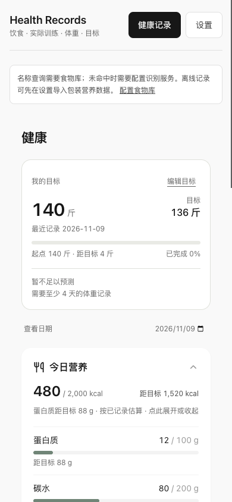

# Acceptance record

Date: 2026-11-09. Environment: Node.js 22.22.2, local macOS, Chromium-based EGO browser. All health records and browser uploads used for acceptance were invented test fixtures. No private instance, existing health record, production deployment or real-person photo was used.

## Automated checks

- Fresh `npm ci --ignore-scripts --no-audit --no-fund` completed from the lockfile. `npm run build` succeeded.
- `npm test`: 332 Vitest tests across 23 files, plus 29 Node tests, all passed.
- Shared-store coverage includes validation, full-snapshot conflict protection, strong ETags, create-only writes, exact mutation replay, failed/lost write receipt handling, same-session UI retry and stale account guards.
- Real stdio client → local persistent DAV: meals, actual workouts, weights and primary goal; fourteen tools discovered; repeated request produced one record; stale update failed; half-portion replay did not halve twice; disk bytes survived service restart.
- OAuth HTTP: discovery, PKCE, owner consent, tokens, refresh rotation/replay revocation, read-only/health-only/combined permissions and all fourteen tools under explicit complete scope grant. Unauthenticated MCP, foreign Origin and Host requests were rejected.
- Local development adapter: atomic compare-and-replace, concurrent same-version writes with one winner, no cross-owner/arbitrary file access, single writer, missing AI configuration, server-side key/model mapping, and safe port-conflict shutdown.
- Review reproduced a startup defect where a listen-port conflict left `.writer.lock`. A subprocess regression failed before the fix and passed afterward. Crash locks intentionally require manual safe recovery documented in README.

## Browser acceptance

On a fresh random loopback origin, the browser performed connection setup, explicit synthetic food-library import, fictional profile/goal/weight/workout saves, and manual food recording. Narration returned a review draft; changing 200 g to 100 g changed the saved portion once. A generated drawing passed through mocked photo recognition and its 100 g confirmation was saved. A forced provider failure retained the narration text. Reload preserved the saved records.

A real stdio MCP client then read those same browser-written files: three meals, one workout, one weight and one goal; meal total 480 synthetic kcal; photo record 100 g. This checks shared storage across interfaces, not the nutritional truth of fixture values.

390 × 844 mobile view had document width 390 with no horizontal overflow. Desktop 1440 × 960 was visually inspected. The browser request origins remained the local test origin. Normal scrolling and all exercised buttons/forms worked. Full screen-reader and exhaustive keyboard accessibility audits were not performed.

## Small live-model smoke check

A separate acceptance run used the runtime proxy and the original vision parsing functions with the official OpenAI API and `gpt-4.1-mini`. Both inputs were invented: a typed 100 g apple request returned a structurally valid single result retaining 100 g; a narration containing one breakfast egg and 200 g lunch rice returned exactly two items with the stated meals and rice portion, tagged `source: "ai"`. Each request completed in about 1.7 seconds in this one run.

A third live request exercised the actual browser upload, image compression, runtime proxy and the same `gpt-4.1-mini` vision model with a generated blue-teapot image containing no food. The page displayed “没识别到食物，请重拍或手动输入” and still showed zero food records. The input is the public [image-mcp generated sample](https://github.com/bmdy6/image-mcp/blob/main/docs/readme/smoke-text.png), not a real-person photo.

These are small compatibility smoke tests, not a benchmark or evidence of nutritional accuracy. The browser photo happy path above used a mock provider and a generated test drawing. Real-food photo accuracy, broad provider compatibility and production reverse-proxy deployment remain unverified by this record.

## First-use limits

No third-party nutrition database is bundled. With neither imported food data nor AI configured, web users can record profile, workouts, weight and goals, but cannot estimate an unknown food by name. They can fill and import the provided food template with their own verified packaging values; MCP can save explicitly supplied meal values without a model. Empty template numeric fields are rejected. The local adapter is development-only; external strong-ETag WebDAV is the production storage contract.

Legacy profile settings use whole-file saving, without record-level concurrent merge. Model estimates, inferred targets and incomplete recording coverage must not be treated as clinical conclusions. Public-host deployments, real data migration and medical effectiveness were not tested.
